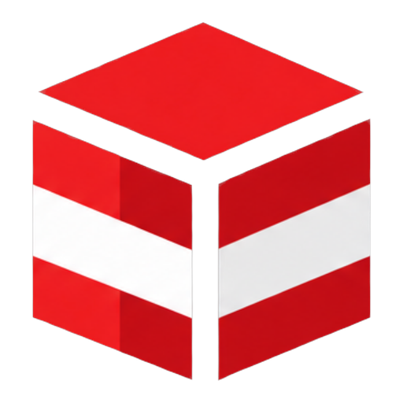

  

<h1 align="center">TNT Velocity Preview</h1>

  Preview how exploding TNT pushes other primed TNT in Minecraft Bedrock Edition — right in your browser.

  <a href="https://cbrusmcyt.github.io/tnt-velocity-preview/"><b>▶ Try the Live Demo</b></a>

---

### What is this?

A small, dependency-free web tool for testing TNT knockback before you build it in-game.

Spawn TNT at any position, set its fuse and starting velocity, then watch how each explosion pushes the rest. No install, no account, just open the link and play.

### Chamber

The main screen is the **TNT Simulation Chamber**, available in 3 views:

- **2D Side view (X-Y)** — see height and horizontal knockback
- **2D Top view (X-Z)** — see spread and direction
- **3D Orbit view** — textured TNT cubes you can rotate, pan, and zoom

### What you can do

- **Spawn TNT** with custom position, fuse, starting velocity, count, and Stack / Cube layout
- **Spawn Momentum** on / off — the small random kick Bedrock gives when TNT spawns
- **Presets** — save your setups as cards, then Play, Record, Edit, or Delete them in one click
- **Record** — export your simulation as a video at 1024×1024, 60 FPS, with white, black, green, or transparent background
- **Export to Bedrock** — save your TNT as a `.mcstructure` file and load it straight into a world
- **Import / Export presets** — share setups as `.tntpreset` files

### Themes

Pick a look that fits you, from the menu (☰ top left):

- **Light** — clean default
- **Dark**
- **Light Bordered / Dark Bordered**
- **OreUI** — square, beveled look modeled on Minecraft Bedrock menus
- **Custom** — edit almost everything: colors, border, corner radius, then export it as a `.tntheme` file

### Controls

| Input | Action |
| --- | --- |
| Drag | Rotate (3D) or pan (2D) |
| Two-finger drag / Pinch | Pan / Zoom |
| Shift + drag, right-drag | Pan in 3D |
| Mouse wheel / pinch | Zoom |
| `Space` | Play / Pause |
| `S` | Advance one tick |
| `R` | Reset |
| `F` | Focus on all TNT |
| `C` | Center camera at 0, 0, 0 |
| `B` | Toggle TNT border |
| `Esc` | Close menu |

> The full explanation of every button lives inside the app, in **Menu > Guide**.

### How the simulation works

Each tick, TNT moves with Bedrock-style physics:

- Gravity `-0.04`, air drag `0.98`
- On the ground, extra horizontal friction `×0.4` and vertical bounce `×-0.5`
- Floor at `Y = 0`

When TNT explodes (power 4), nearby TNT are pushed along the explosion sphere. By default, TNT in the same tick explode one after another, so each explosion can move the TNT that haven't exploded yet — just like in-game chain reactions. You can also switch to exploding them all at once.

### Accuracy

The knockback formula follows the Minecraft Wiki's Bedrock section, which still marks parts of Bedrock behavior as unverified. Movement constants and spawn momentum come from community input. Treat results as a close approximation and always compare against the game.

### File formats

- **`.tntpreset`** — a saved preset: your TNT setups, ready to share
- **`.tntheme`** — a custom theme: colors, border, and corner radius
- **`.mcstructure`** — a Bedrock structure with your TNT's start position, velocity, and fuse

---

This project is not affiliated with or endorsed by Mojang or Microsoft.

The Bedrock knockback formula is based on the [Minecraft Wiki](https://minecraft.wiki/w/Explosion).
